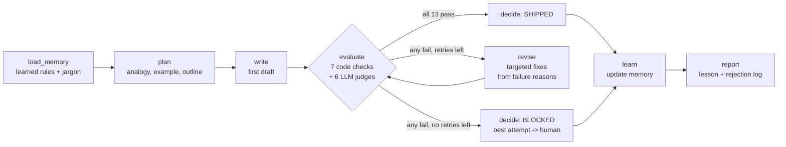

# LessonGen: a self-evaluating lesson generator

An agentic system that **writes a beginner lesson, grades it against a hard pass/fail rubric, and rewrites it until it is good enough to ship.** If it still fails after 2 retries, it refuses to ship and flags the lesson for a human.

- **Topic for this submission:** Introduction to RAG (Retrieval-Augmented Generation)
- **Learner:** a 12th-grade graduate from India who studied in a non-English-medium school, has limited English vocabulary, and is starting from zero in AI.
- **Stack:** Python + LangGraph. Works with any model: Anthropic, OpenAI, Gemini, Groq, AWS Bedrock, or Ollama.

> The reasons behind each design choice (why this structure, this evaluator, and these trade-offs) are in **[DESIGN.md](DESIGN.md)**.

---

## How it works



| Step | What it does |
|---|---|
| **Topic spec** (`topics/rag.yaml`) | Human-checked ground truth: 8 key points, reference facts, known misconceptions, and a list of jargon words. The writer and the evaluator both use it, so accuracy is checked against facts, not against the model's opinion. |
| **Plan** | Picks one everyday Indian analogy, designs the worked example, and maps key points to sections. |
| **Write** | Writes the lesson from a fixed 9-section template: why → what → how → example → limits → recap → glossary → quiz. |
| **Evaluate** | Runs 13 checks, each either PASS or FAIL. There are no scores, no weights, and no partial credit. The lesson ships only if all 13 pass. |
| **Revise** | Gets each failed check's reason, the exact problem text, and a fix instruction, plus a list of checks that already pass ("don't break these"). It makes targeted edits and records what it changed. |
| **Decide** | Ships on a full pass. Otherwise it keeps the best attempt and marks it **NOT SHIPPED**. The loop runs at most 1 + 2 times. |
| **Learn** | Updates memory: turns failures into writing rules, promotes repeatedly flagged hard words into the rubric, and tracks whether each rule actually helps. |

### The rubric (13 hard checkpoints)

| # | Check | How it's checked | Passes when |
|---|---|---|---|
| 1 | `structure` | code | All 9 sections are present, in teaching order |
| 2 | `length` | code | 900–2,600 words |
| 3 | `readability` | code | Flesch-Kincaid grade ≤ 8, average sentence ≤ 15 words |
| 4 | `sentence_length` | code | No sentence over 30 words |
| 5 | `glossary_coverage` | code | Every jargon word used is in the Glossary |
| 6 | `misconception_tripwire` | code | No dangerous misconception is stated as fact (negation-aware) |
| 7 | `quiz_format` | code | 3–5 questions, each with an answer |
| 8 | `accuracy` | LLM judge | Every claim matches the reference facts, including quiz answers |
| 9 | `key_points` | LLM judge | Every key point is taught, **proved with a quote that code verifies** |
| 10 | `jargon_explained` | LLM judge | Each term is explained at first use, not only in the glossary |
| 11 | `plain_language` | LLM judge | No idioms, no rare or formal words, no unfamiliar cultural references |
| 12 | `examples` | LLM judge | An everyday analogy, plus a worked example showing question → retrieved text → prompt → answer |
| 13 | `flow` | LLM judge | Ideas come before they are used, there are no contradictions, and the example matches the steps |

Print it any time with `python -m lessongen rubric`.

---

## Setup

```bash
git clone <this repo> && cd lessongen
python -m venv .venv && source .venv/bin/activate      # Windows: .venv\Scripts\activate
pip install -r requirements.txt
cp .env.example .env        # then set LLM_PROVIDER and the matching API key
```

There is no paid key? Gemini (`LLM_PROVIDER=gemini`) and Groq (`LLM_PROVIDER=groq`) both have free tiers. For Bedrock, set `LLM_PROVIDER=bedrock`, `AWS_REGION`, and `LLM_MODEL` to a model or inference-profile ID you have access to.

**Recommended:** use a different model as the judge (`JUDGE_PROVIDER` / `JUDGE_MODEL`), so the writer is not grading its own homework.

## Run

```bash
# 1. Full loop: generate -> evaluate -> regenerate until it ships
python -m lessongen run --topic "Introduction to RAG"

# 2. Show the evaluator catching a deliberate error. The first draft is corrupted,
#    the evaluator rejects it, and the reviser fixes it.
python -m lessongen run --topic "Introduction to RAG" --inject-error misconception
#    error kinds: misconception | jargon | long_sentence | drop_example | wrong_quiz | all

# 3. Evaluate any lesson file. Add --code-only to skip the LLM judges (no API key needed).
python -m lessongen evaluate output/lesson.md --inject-error jargon
python -m lessongen evaluate tests/fixtures/good_lesson.md --code-only --inject-error all

# 4. Give human feedback. It becomes memory: writing rules, enforced jargon, judge calibration.
python -m lessongen feedback "My students did not understand the word 'semantic'"
python -m lessongen feedback --check plain_language --calibrate "Do not flag 'chatbot'; students know it."
python -m lessongen feedback --rule "Use rupees, not dollars, in money examples."

# 5. See what the system has learned across runs
python -m lessongen memory
```

Exit codes: `0` = shipped, `2` = blocked (needs human review), `3` = LLM/config error.

### Offline demo (no API key)

```bash
bash replay/demo.sh
```

This runs the **real pipeline end-to-end** with `LLM_PROVIDER=replay`, where pre-written responses stand in for the model (see [replay/README.md](replay/README.md)). Run 1 injects a misconception into a draft that also has natural mistakes. The draft is rejected on 7 checks, revised, and shipped on attempt 2, and memory learns 3 rules. Run 2 shows those rules in the writer's prompt and ships on the first attempt. Every prompt sent is saved to `replay/run*/_prompts/`.

## Outputs

| Path | Contents |
|---|---|
| `output/lesson.md` | The final lesson that passed. If it was blocked, the file is `lesson_NEEDS_REVIEW.md` and has a warning banner. |
| `output/rejection_log.md` | A scoreboard of every check on every attempt; what failed, why, and the quoted evidence; what the reviser changed; and what memory learned. |
| `runs/<run_id>/` | The full audit trail: `plan.json`, `attempt_N.md`, `eval_attempt_N.json`, and `rejection_log.json` |
| `memory/memory.json` | Persistent memory, shared across runs. Human-readable. |

## Memory and self-evolution

`memory/memory.json` persists across runs and is updated after every run:

- **Prompt evolution:** a reflector step turns this run's failures into short, general writing rules (for example, "Define every technical word the first time you use it"). The top rules are added to the planner and writer prompts on the next run. Each rule tracks how often its check passed on the first try when the rule was applied. A rule that keeps failing is flagged as *ineffective*, and the reflector rewrites it.
- **Rubric evolution:** words the judges flag as hard for this learner are counted. Once a word is flagged in 2 runs, it becomes an enforced jargon term, so the deterministic glossary check now requires it to be defined.
- **Judge calibration:** human corrections (for example, "this was a false positive") are stored per check and added to that judge's prompt.
- **Stats:** per-check failure rates and the first-attempt pass rate across runs, shown by `python -m lessongen memory`.

## Tests (offline, no API key)

```bash
pytest -q
```

18 tests drive the real LangGraph loop with a scripted fake LLM. They cover every injected error being caught; the loop fixing an error on retry; the loop stopping and blocking after the maximum retries; a judge that "passes" with a made-up quote being overruled; a judge crash counting as FAIL; learned rules appearing in the next run's prompt; a repeatedly flagged word becoming an enforced rubric term; and the replay demo running end-to-end.

## Repository layout

```
lessongen/
  graph.py         LangGraph state machine (nodes, routing, termination)
  agents.py        planner, writer, reviser
  evaluator.py     runs all checks; LLM-judge guards (quote verification, consistency)
  checks_code.py   7 deterministic checks
  rubric.py        check definitions + thresholds + lesson template
  prompts.py       every prompt in one file
  memory.py        persistent memory + rule effectiveness tracking
  learn.py         reflector (failures -> rules) and human feedback
  inject.py        deliberate-error injection for demos and tests
  report.py        rejection log + run artefacts
  topic_spec.py    load the curated spec, or draft one for a new topic (marked unverified)
  llm.py           provider-agnostic client (Anthropic/OpenAI/Gemini/Groq/Bedrock/Ollama) + replay mode
topics/rag.yaml    human-curated ground truth for the RAG lesson
replay/           offline demo: pre-written model responses for 2 runs (bash replay/demo.sh)
tests/             offline test suite + fixtures
```
